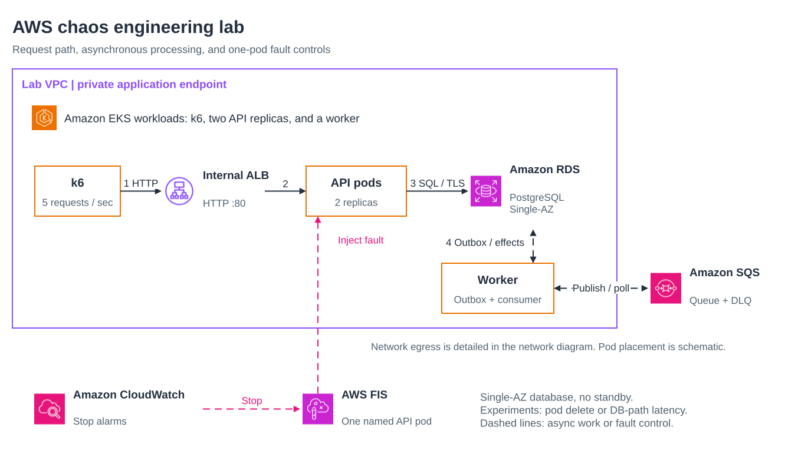

# AWS chaos engineering lab

A small, measurable lab for testing one fault at a time on AWS. It runs a synthetic loan-request API on Amazon EKS with Amazon RDS for PostgreSQL, Amazon SQS, and an internal Application Load Balancer. AWS Fault Injection Service (FIS) then deletes one API pod and, separately, adds latency to one pod's database path.

Everything is Terraform. Experiments are started by a person in the FIS console after a target preview.

## What you get

[](docs/diagrams/overview.svg)

- A dedicated VPC across two AZs, with private and isolated data subnets, one NAT gateway, and no public application endpoint.
- EKS with one node per AZ, two API replicas, a worker, a collector, and k6.
- RDS for PostgreSQL with IAM authentication, an outbox, and SQS with a dead-letter queue for async processing.
- CloudWatch logs, stop alarms, and a dashboard.
- Two FIS experiment templates, one pod delete and one network latency, each scoped to a single named pod.
- Five Terraform roots with separate state, built from small internal modules.

The full diagram, request path, and component list are in [docs/architecture.md](docs/architecture.md).

## What one run showed

These numbers come from [evidence/sanitized/results.json](evidence/sanitized/results.json).

- Baseline: 5,310 requests, 100% logical success, p95 8 ms. Four needed one retry.
- One pod deleted: 600 of 600 requests succeeded in the next two minutes, and the replacement was Ready in 11 seconds.
- 100 ms configured delay on one pod's database path: 0 logical errors, but client p95 rose to 426 ms.
- Verifier: 13,220 acknowledged writes, 0 missing, 0 duplicate business effects.

Limits: synthetic traffic, one pod at a time, a Single-AZ database, and no Availability Zone outage. Your numbers will differ.

## Cost warning

This creates billable resources, including an EKS cluster, two EC2 nodes, a NAT gateway, an internal ALB, and an RDS instance. They cost money every hour until you destroy them. The budget alert in `infra/modules/budget-guardrail` only sends email. It does not stop anything. Check current pricing for your Region before you apply, and plan when you will tear the lab down.

Use an AWS account you own and that is isolated from anything important.

## Layout

```text
app/          TypeScript API, worker, migration, verifier, and collector (one image)
load/k6/      Synthetic load script
infra/
  bootstrap/  Terraform state bucket
  envs/lab/   evidence, foundation, workloads, experiments roots
  modules/    Internal modules, most wrapping terraform-aws-modules
experiments/  Hypotheses for each fault
evidence/     Sanitized results from one run
scripts/      Structure, scrub, and evidence helpers
docs/         Runbook, subnet notes, and sources
```

## Prerequisites

Terraform 1.14.6, Node 22, npm, AWS CLI v2, Docker, kubectl, Python 3, jq, Git, and ripgrep. An AWS account with a default VPC in the Region you pick (the foundation looks it up only to refuse to deploy into it), two Availability Zones, and permission to create the resources above.

## Run it

Follow [docs/runbook.md](docs/runbook.md). In short:

1. Set your inputs as environment variables. No tfvars files are committed.

   ```bash
   export AWS_PROFILE=your-profile
   export TF_VAR_region=us-west-2
   export TF_VAR_allowed_account_id=123456789012
   export TF_VAR_availability_zone_names='{"az_a":"us-west-2a","az_b":"us-west-2b"}'
   export TF_VAR_operator_cidr="$(curl -fsS https://checkip.amazonaws.com)/32"
   export TF_VAR_budget_notification_email=you@example.com
   ```

2. Bootstrap the state bucket, then move its state into that bucket.
3. Apply `infra/envs/lab/evidence`, then `infra/envs/lab/foundation`.
4. Build and push the app image to the new ECR repository, then apply `infra/envs/lab/workloads` with load off.
5. Turn on load, record a baseline, and set the detection alarm from it.
6. Apply `infra/envs/lab/experiments` with the current API pod name, preview the target in the FIS console, and start each experiment there.
7. Collect evidence and run the verifier.
8. Destroy experiments, workloads, and foundation, then retire the evidence and state buckets.

## Checks

```bash
./scripts/check-terraform-structure.sh
./scripts/test-sharing-scrub.sh
./scripts/check-sharing-scrub.sh
terraform fmt -check -recursive infra
npm ci --prefix app && npm test --prefix app && npm run build --prefix app
```

The FIS module has a mocked `terraform test` that does not call AWS.

## Walkthrough

The slide walkthrough of this lab, with diagrams and the results above, is on LinkedIn: [read the post](REPLACE_WITH_LINKEDIN_POST_URL). The slides are not part of this repository.

Sources for the AWS facts are in [docs/sources.md](docs/sources.md).

## License

MIT for the original code in this repository. See [LICENSE](LICENSE) and [THIRD_PARTY_NOTICES.md](THIRD_PARTY_NOTICES.md).
