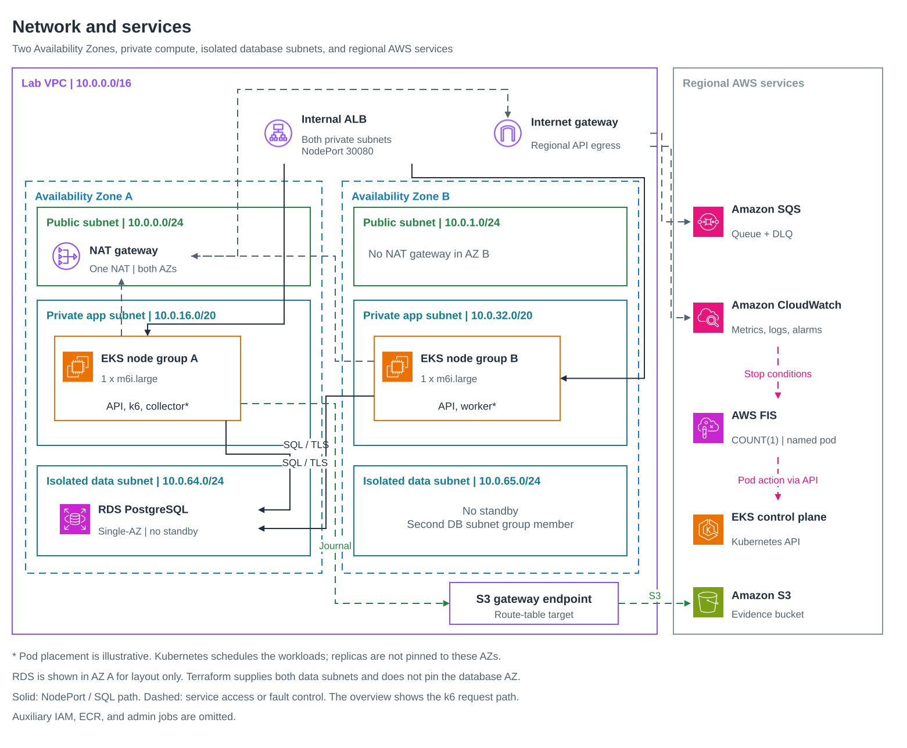
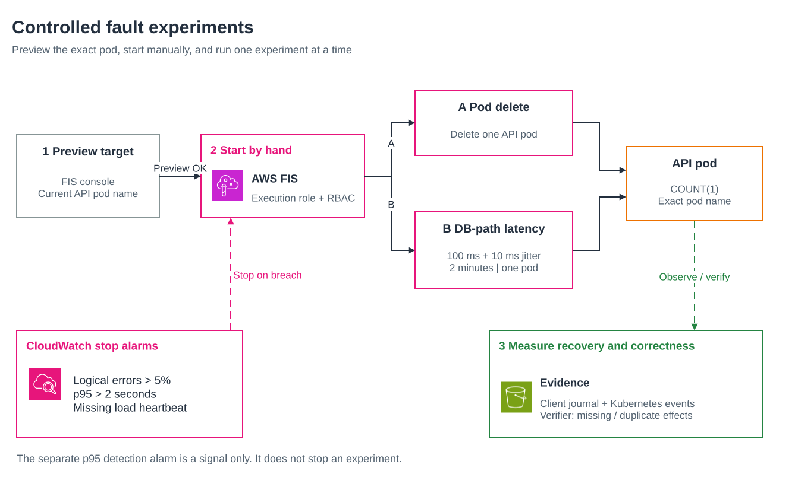
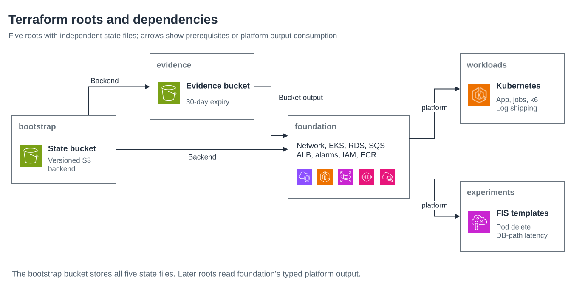

# Architecture

This is what Terraform creates in your account. Pod placement across Availability Zones is up to Kubernetes, so the diagrams show it schematically. RDS is Single-AZ; its illustrated AZ is not pinned by Terraform.

## Network and services

## The request

1. k6 runs inside the cluster and sends five synthetic loan requests per second to the internal ALB.
2. The ALB forwards to a node on NodePort 30080. Kubernetes picks a ready API pod.
3. The API writes the request and an outbox row to PostgreSQL in one transaction, then returns HTTP 202.
4. The worker publishes the outbox row to SQS, consumes it, and records exactly one processed effect.

Idempotency keys make retries safe. The same key with the same payload returns the original request, and a different payload returns 409.

## The experiments

Each FIS template selects exactly one pod by name with `COUNT(1)`. The stop alarms fire on logical error rate above 5 percent, p95 above 2 seconds, or a missing load heartbeat. A separate detection alarm on p95 is a signal only.

## Components

- **Network:** one VPC across two AZs, public, private, and isolated data subnets, one NAT gateway, and an S3 gateway endpoint. No peering and no public application endpoint.
- **Compute:** EKS 1.34 with two managed node groups, one `m6i.large` per AZ. The EKS API is private plus a public endpoint limited to your `/32`.
- **App:** one TypeScript image with five commands: `api` (two replicas, a pod disruption budget, and probes), `worker`, `collector`, `migrate`, and `verify`. Logs go to CloudWatch through Fluent Bit.
- **Data:** RDS for PostgreSQL 17 on `db.t4g.small`, Single-AZ, encrypted, with IAM database authentication. RDS manages the master password in Secrets Manager. Only the migration job can read it.
- **Messaging:** an SQS queue with a dead-letter queue.
- **Load:** a k6 deployment at zero replicas until you turn it on.
- **Observability:** log groups, four alarms, and a dashboard.
- **Fault injection:** a scoped FIS execution role, two FIS templates, and namespace-only Kubernetes RBAC for FIS.
- **Guardrails:** a permissions boundary on lab roles, an account allowlist on every provider, a budget with email alerts, and a check that refuses the default VPC.
- **State and evidence:** a versioned state bucket, and an evidence bucket whose objects expire after 30 days.

## Terraform roots

Each root has its own state file. Roots only call modules, and later roots read one typed `platform` output from foundation.

## Not included

No Multi-AZ database, no RDS failover experiment, no AZ outage, and no Resilience Hub or Application Recovery Controller. The database failover hypothesis is written down in `experiments/c-rds-failover` but was not run.
